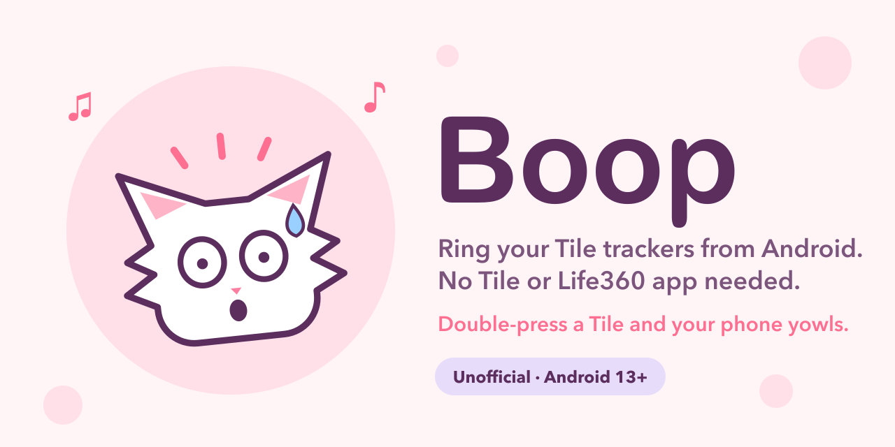

# Boop



Ring your own Tile trackers from an Android phone without the Tile or Life360 app. And the
other way around: double-press a Tile to make the phone yowl.

Each Tile shows up as a sleepy kitty. Tap **Boop!** and the kitty panics while the Tile plays its
song. Turn on **Kitty watch**, and a double-press on any Tile sets off a loud alarm on the phone
(it plays even on silent) until you double-press again or tap **Found it!**.

Unofficial. Not affiliated with Tile or Life360.

## How it works

Tiles speak Tile's TOA protocol over Bluetooth LE: the `FEED` service, a write characteristic
`9d410018-…` and a notify characteristic `9d410019-…`. Every command is signed with a 16-byte key
unique to each Tile (`auth_key`). The Tile never reveals that key. Tile's cloud hands it to the
account owner at login. So:

1. **Once**, `mac/get_keys.py` logs in to the Tile cloud and saves each Tile's key to
   `tile-keys.json`.
2. You import `tile-keys.json` into Boop once. It keeps the keys encrypted in app-private
   storage, with an AES key held in the Android Keystore. The APK itself contains no keys.
3. From then on everything is local Bluetooth. No cloud, no account, no Tile app.

**Kitty watch** is a foreground service that holds an authenticated connection to every Tile in
range, because a Tile only reports button presses to a connected app. Presses arrive on the Tile's
broadcast channel as `01 06 02 <00 single | 02 double> MIC[4]`. A double-press sends
`00, 00, 02`, so only `02` counts. It works alongside the official Tile app, since a Tile serves
several channels at once.

## Install a release

There's no Play Store listing. Each [release](https://github.com/BufferUnderrunOK/boop/releases)
has a signed `boop-vX.Y.Z.apk` and `get_keys.py`. **This is not for the faint of heart.** You'll
be using a terminal and sideloading an app over USB. If "adb" means nothing to you yet, expect an
afternoon of learning before it works.

You need an **Android 13+ phone**, a computer with **Python 3** and
[**adb**](https://developer.android.com/tools/releases/platform-tools), and your **Tile account**
email and password.

1. **Get your keys** (once): `python3 get_keys.py` asks for your Tile login and writes
   `tile-keys.json`. Only the keys are saved.
2. **Turn on USB debugging:**
   1. Settings → About phone → tap **Build number** 7 times to unlock Developer options.
   2. Settings → System → Developer options → turn on **USB debugging**.
   3. Plug the phone in and tap **Allow** on the "Allow USB debugging?" prompt. `adb devices`
      should then list it as `device`, not `unauthorized`.
3. **Install and copy your keys over:**
   ```
   adb install -r boop-vX.Y.Z.apk
   adb push tile-keys.json /sdcard/Download/
   ```
4. Open Boop, tap **Import tile-keys.json**, pick it from Downloads, then delete the copy in
   Downloads. USB debugging can go back off.

**Updates:** `adb install -r` the newer APK; your imported keys are kept. Releases are signed with
the project's release key, so a copy you built yourself can't be updated by a release (or the
other way round). Uninstall it first, then re-import your keys.

## Build it yourself

For compiling it from source instead.

You need:

- Everything from "Install a release", plus **JDK 17 or newer**.
- The **Android SDK** command-line tools, with platform 36 and build-tools installed, and
  **adb** (Android platform-tools) on your `PATH`.
- An **Android 13+ phone** with USB debugging on (steps above).

Then:

```
python3 mac/get_keys.py      # asks for your Tile email + password; saves only the keys
./gradlew assembleDebug
adb install -r app/build/outputs/apk/debug/app-debug.apk
adb push tile-keys.json /sdcard/Download/
```

Open Boop, tap **Import tile-keys.json** and pick it from Downloads, then delete the copy in
Downloads. The original stays on your computer.

`get_keys.py` uses only the standard library; despite the folder name it runs anywhere. Adding a
Tile later means running it again and importing the new file ("New Tile?" at the bottom of the
list); no rebuild needed. Once Boop is installed you can turn USB debugging off again. You'll only
need it to install updates.

## Read this before you use it

- **`tile-keys.json` is the keys to your Tiles.** It's git-ignored; keep it that way, and don't
  leave copies lying around on your phone. The APK itself holds no keys.
- **Never factory-reset a Tile, have Tile support deactivate it, or delete your Tile/Life360
  account.** A reset re-activates the Tile, very likely under a new key. Tile says deactivation
  and account deletion permanently disable Tiles.
- **Hiding a Tile in the Tile app is fine.** Tested: a hidden Tile still rings and still sends
  double-presses to Boop.
- `get_keys.py` talks to Tile's private API using the iOS app's headers, the same as
  [pytile](https://github.com/bachya/pytile) and Home Assistant's Tile integration. It may break
  if Tile changes the API, so fetch your keys while it still works.
- Tested end to end on one Tile model (product code `ROYAL_ST1`): ringing and double-press. Two
  other models connected and authenticated, but ringing them wasn't tried.

## Mac test harness (optional)

`mac/` holds the scripts used to prove the protocol before the app existed. They drive a USB
Bluetooth dongle (a TP-Link UB500 here) directly with
[Bumble](https://github.com/google/bumble), bypassing macOS's Bluetooth stack.

```
python3 -m venv .venv && .venv/bin/pip install bumble
# The UB500's Realtek chip needs rtl8761bu_fw.bin + rtl8761bu_config.bin from linux-firmware
# (rtl_bt/) in ./firmware. They are not included here.
BUMBLE_RTK_FIRMWARE_DIR=firmware .venv/bin/python mac/scan.py 30
BUMBLE_RTK_FIRMWARE_DIR=firmware .venv/bin/python -u mac/ring.py <TILE-ADDRESS>
```

A Tile that's connected to a phone stops advertising, so turn that phone's Bluetooth off first.

## Credits

Built on the reverse-engineering in [node-tile](https://github.com/lesleyxyz/node-tile),
[tile-wear](https://github.com/colonelpanic8/tile-wear) and
[python-tile-ble](https://github.com/joostlek/python-tile-ble), all MIT-licensed. See
[THIRD_PARTY_NOTICES.md](THIRD_PARTY_NOTICES.md). Boop itself is MIT ([LICENSE](LICENSE)).
